<p align="center">
  <picture>
    <source media="(prefers-color-scheme: dark)" srcset="media/logo-dark.png">
    
  </picture>
</p>

<p align="center"><b>Expert annotation of medical images, one highlighted term at a time.</b></p>

<p align="center">
  Built to collect ground truth for <b>OpenMedSeg</b>, an explainable AI project for medical imaging<br>
  with researchers from Stanford Medicine, Mount Sinai, the Hasso Plattner Institute and Charité.
</p>

<p align="center">
  <a href="https://github.com/ArkhunAbdullazade/CliniMark/actions/workflows/image.yml"></a>
  
  
  <a href="LICENSE"></a>
</p>

<p align="center">
  <a href="#how-it-works">How it works</a> ·
  <a href="#for-specialists">Specialists</a> ·
  <a href="#for-students">Students</a> ·
  <a href="#the-admin-panel">Admin panel</a> ·
  <a href="#the-data">The data</a> ·
  <a href="#design-decisions">Design decisions</a> ·
  <a href="#running-it">Running it</a>
</p>

<br>

<p align="center">
  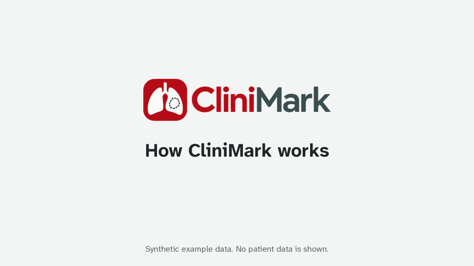
</p>
<p align="center"><sub>A 30-second tour, recorded on synthetic images.</sub></p>

<br>

## How it works

Clinical case reports pair an image with a written description of what it shows. CliniMark turns that pairing into training and evaluation data. A specialist reads the description with its medical terms highlighted and outlines where each term appears in the image. Medical students annotate the same images with labels of their own. Every outline is stored as coordinates in the image's own pixels and as a pixel mask that a segmentation model can be scored against.

1. A participant signs up and chooses the images they're qualified for: at least one image modality, plus any specialities and body regions.
2. On their first visit, a 3-minute narrated tutorial plays once, all the way through.
3. A specialist receives one case at a time and works through its highlighted terms.
4. Before the next case, they confirm or correct the image's modality, speciality and body region.
5. Medical students get their own queue, outline what they can identify and name it.
6. The study team follows progress in the admin panel and exports results and masks whenever they need them.

## For specialists

<p align="center">
  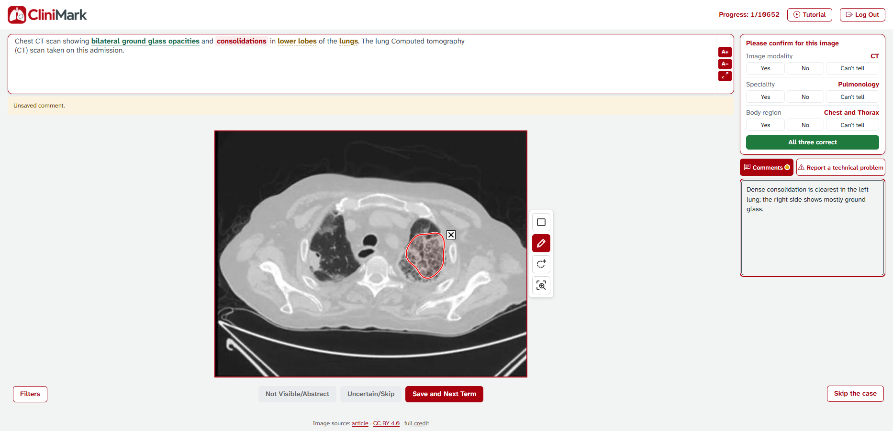
</p>
<p align="center"><sub>The specialist workspace on the test deployment. One term is saved in green, the current term is red, and a comment is open.</sub></p>

For every highlighted term, the specialist chooses one of three answers:

- **Outline it** with a boundary box or a freehand contour, using as many shapes as the term needs.
- **Not Visible/Abstract** when the term can't be drawn, like a symptom or a diagnosis.
- **Uncertain/Skip** when they aren't sure.

Comments are saved with the term they belong to. The time from opening a term to the first stroke, and from there to saving, is recorded for every answer.

<p align="center">
  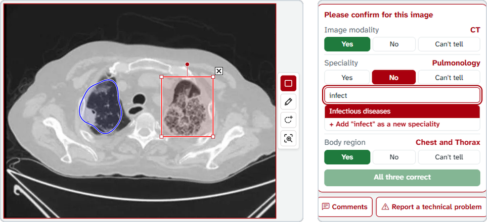
</p>
<p align="center"><sub>Left: the drawing tools. Right: correcting a label that doesn't fit the case.</sub></p>

**Drawing.** A selected box can be moved, resized from its corners, rotated from the round handle and deleted with X. Zoom to Area enlarges a region for close work. The dashed tool, **Custom annotation**, outlines a finding the text doesn't mention; the specialist names it and it's saved at once.

**The label check.** Next Image stays locked until the specialist answers three questions about the image's modality, speciality and body region: Yes, No or Can't tell. Answering No opens a search over the study's labels, and a missing value can be added. In the example above, a mucormycosis case labelled Pulmonology is corrected to Infectious diseases. The original label is kept, and the correction is stored beside it in `MetadataChecks`.

**When something goes wrong.** **Report a technical problem** reaches the study team straight away, even if the image or the tools fail to load. **Skip the case** hands a case outside the specialist's field back to the pool. It's never offered to them again, and anything they saved on it is copied to `ImageSkips.DiscardedWork` first.

## For students

<p align="center">
  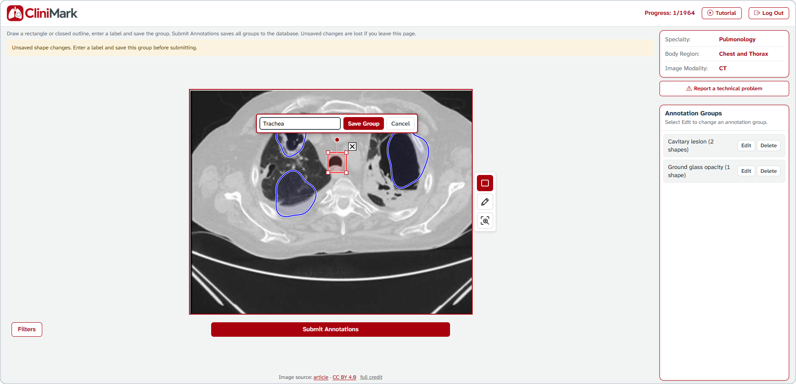
</p>
<p align="center"><sub>Two groups are saved, and a third shape is being named.</sub></p>

Students outline whatever they can identify and type their own label. Several shapes can share one label, like the two cavities grouped above. Groups stay editable until the student submits the image. Their answers are a second, independent set for the study to compare with the specialists'.

## Signing up and choosing images

Each participant has their own account and password; there's no shared study password. Choosing **medical student** as the position opens the student workspace, and any other position opens the specialist one.

Image modality is required. Speciality and body region are optional, and leaving one empty means all of its options. An image is offered when it matches one of the chosen options in every list that has a choice. The options are the display labels of the CliniMark datasets (`app_labels/label_vocabulary.csv`, version `app-labels-1.1.0`): 8 modalities, 21 specialities and 14 body regions. Participants can change their choices at any time from the Filters button.

Below every image, both workspaces link the source article and its licence and show the full credit line. The credit sits outside the image's sizing box, so it can't shift the drawing coordinates.

<details>
<summary><b>The sign-up form and the first-visit tutorial</b></summary>
<br>
<p align="center">
  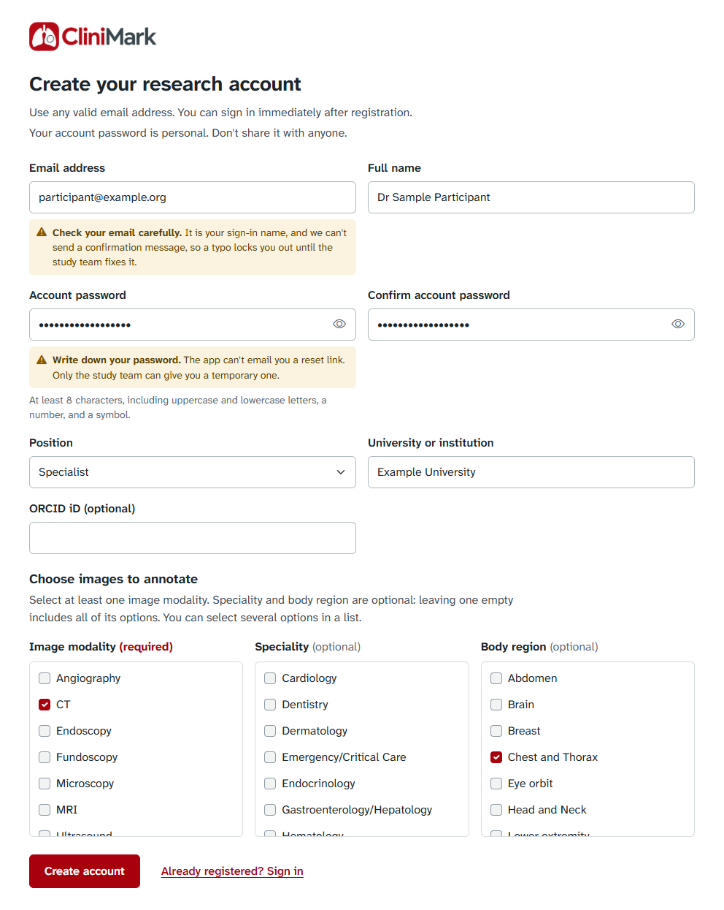
</p>
<p align="center">
  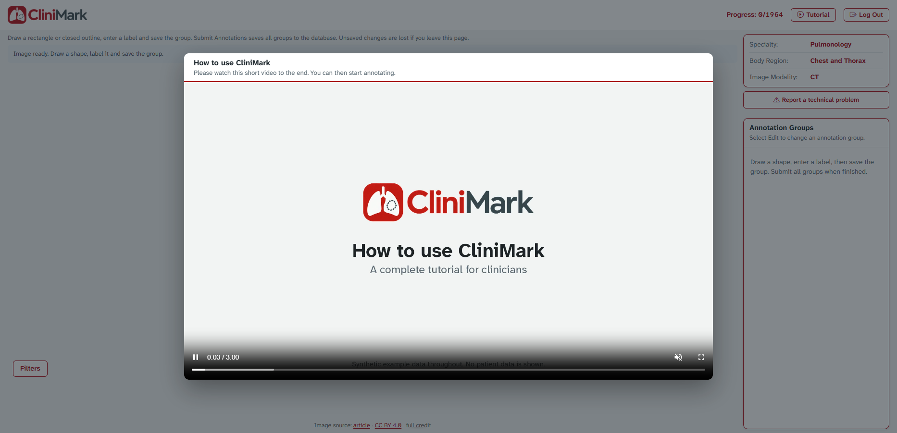
</p>

The tutorial opens by itself on the first visit and can't be skipped ahead. `AspNetUsers.TutorialWatchedAt` records that it was watched. If the video can't load, the participant carries on, and it opens again next time. The Tutorial button in the header replays it whenever they like.
</details>

<details>
<summary><b>Accounts created by the study team</b></summary>
<br>

With `Registration:Enabled=false`, public sign-up closes and the sign-in page says that the study team creates accounts. The team then creates them from a CSV:

```bash
dotnet CliniMark.Presentation.dll create-participants participants.csv credentials.csv
```

- Columns: `Email, FullName, Position, University, ClinicalExperience, OrcidId, Speciality, BodyRegion, ImageModality`. Separate several filter values with `;`, or leave them empty for the participant to choose at first sign-in.
- The whole file is checked first, so nothing is created if any row is invalid.
- Existing accounts are skipped and never changed.
- Generated passwords go only to the credentials file, which must not exist yet.
</details>

## The admin panel

Admins sign in on the same page and land in `/Admin`, a separate area that annotators can't open.

<p align="center">
  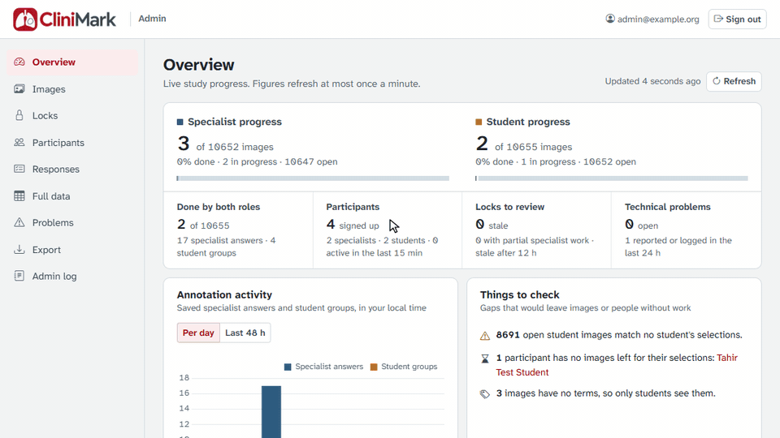
</p>
<p align="center"><sub>A 30-second tour on the test deployment: the overview, one image with every annotation on it, its Full data row and the export.</sub></p>

The overview shows live progress for both roles, activity and drawing times, and it flags problems before they stall the study. Two examples are images that match nobody's choices and participants who have run out of work. Each image has a page that draws every saved annotation over it, one layer per term or group, coloured by term or by annotator. Pointing at a shape highlights the answer it belongs to.

| Page | What it's for |
| --- | --- |
| Images | Every image with its labels, progress and lock |
| Locks | Images reserved for one person, stale and partial work first, released one at a time or together |
| Participants | Each person's choices, progress and current lock |
| Responses | Every saved answer or student group, filtered and downloaded as exactly those rows |
| Full data | One row per image-text pair, with everything anyone saved about it |
| Problems | Problems participants reported, and errors their pages logged on their own |
| Export | The results archive, with or without the image files, and the pixel masks |
| Admin log | Every change made from the panel, and every automatic release |

Create an admin with the operator command `create-admin`.

<details>
<summary><b>Screenshots of the admin pages</b></summary>
<br>
<p align="center">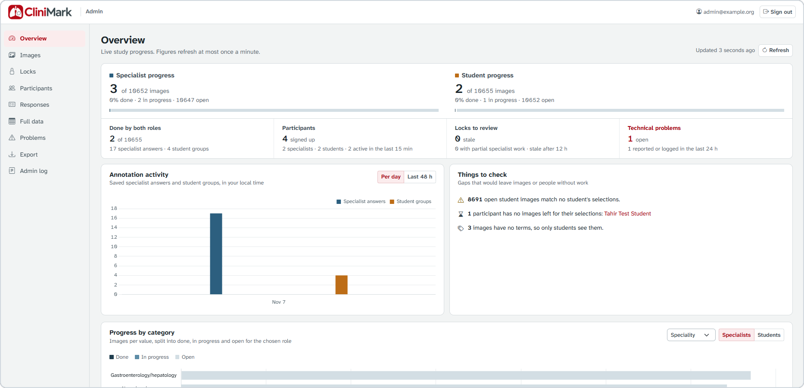</p>
<p align="center">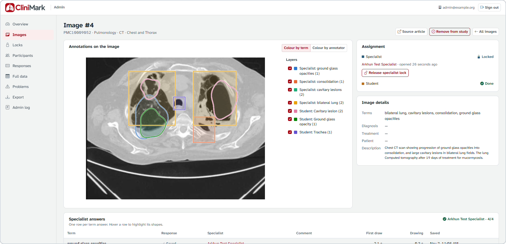</p>
<p align="center">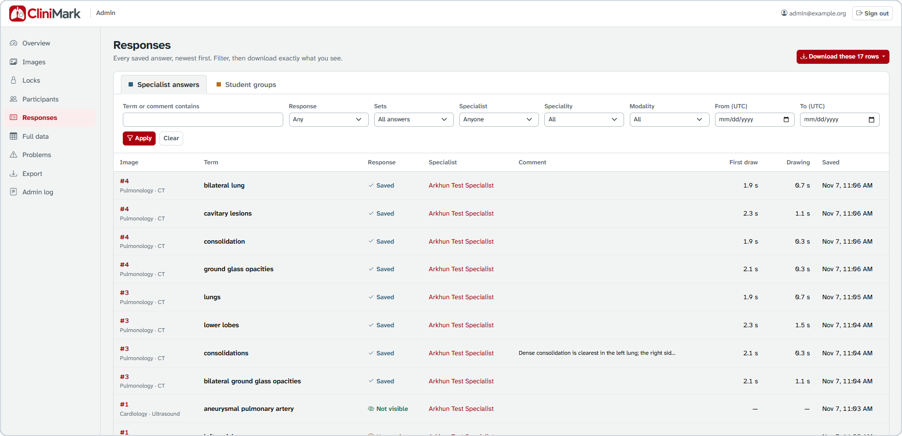</p>
<p align="center">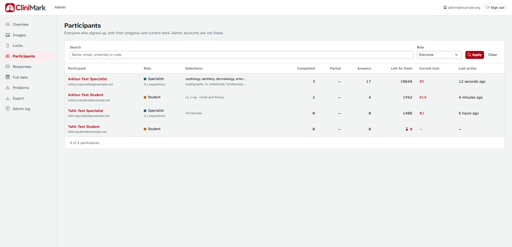</p>
<p align="center">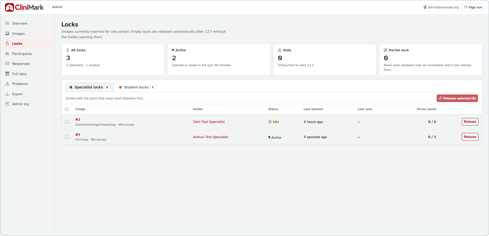</p>
<p align="center">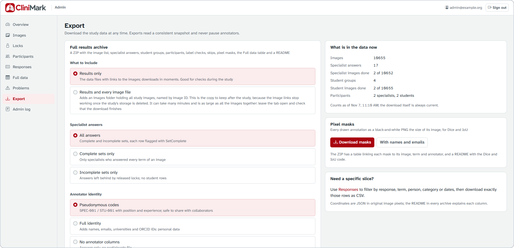</p>
</details>

## The data

<p align="center">
  
</p>
<p align="center"><sub>Two masks from the Export download, a specialist's and a student's, for the same finding on the same CT.<br>They're scored with the Dice and IoU code that ships in every archive.</sub></p>

- **Pixel masks.** Each annotation becomes a black-and-white PNG the size of its image. The server builds it from the saved coordinates under one rule: a pixel is inside when its centre is. Shapes drawn for one term are merged, and a contour that crosses itself is filled throughout. Masks are also stored in the database as COCO run-length encoding. `backfill-masks` creates them for annotations saved before masks existed.
- **Full data.** One row per image-text pair that anyone has touched. It includes every dataset value, every label verdict and correction, and every answer with its coordinates, mask and timing. Custom annotations, student groups, problem reports and skips are in it too. It downloads as CSV or JSON.
- **The results archive.** A ZIP of the image list, answers, student groups, participants, label checks, skips, masks and the Full data table, with a README that explains every column. Annotators appear as pseudonymous codes (`SPEC-001`, `STU-001`) unless the full identity is deliberately chosen.

<p align="center">
  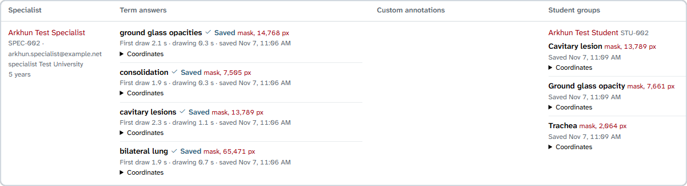
</p>
<p align="center"><sub>Full data for the image above: four specialist answers and three student groups, each with its mask size.</sub></p>

<details>
<summary><b>Main database tables</b></summary>
<br>

| Table | Holds |
| --- | --- |
| `MedDatas` | Each image's metadata, progress and locks |
| `MedDataKeywords` | The terms extracted from each image's text |
| `AnnotatedMedDatas` | Specialists' answers, one row per term |
| `AnnotatedByStudentsMedDatas` | Students' labelled groups |
| `CustomAnnotations` | Findings a specialist outlined and named themselves |
| `MetadataChecks` | Specialists' verdicts on each image's modality, speciality and body region |
| `ImageSkips` | Cases a specialist handed back, with a copy of anything they had saved |
| ASP.NET Core Identity tables | Accounts and roles |
</details>

## Design decisions

Annotation data is only useful if it can be trusted, and most of these choices follow from that.

**One image, one specialist.** Handing out a case takes a PostgreSQL advisory lock (`pg_advisory_xact_lock`). Two specialists who press Next Image in the same instant can't receive the same image, so each image ends up with one complete set of answers instead of several partial ones. Students have their own queue and their own lock.

**Masks are made on the server.** The browser sends only coordinates. Turning them into pixels happens in one place, under one rule, so a mask never depends on someone's screen, zoom level or browser.

**Original labels stay untouched.** A specialist's correction is stored beside the dataset's label, not over it. Where experts disagree with the dataset is a finding in its own right.

**Saves survive a restart.** If the server is restarting when an answer is sent (HTTP 502, 503 or 504, or no connection), the page retries for about 80 seconds. The server refuses a second save of the same term or image, so a retry can't store an answer twice.

**Nothing is quietly lost.** A skipped case keeps a copy of whatever was saved on it. A lock an admin releases keeps its partial work as an incomplete set. Exports read a consistent snapshot, so they never pause annotators.

**Production only starts when it's set up properly.** It never migrates or seeds itself, and startup stops with a clear message if the database, its migrations or the data-protection key path are missing. Pages send a Content Security Policy with a per-request nonce. Sign-in and sign-up are rate-limited per client address, with enough headroom for a group joining from one hospital network.

## Architecture

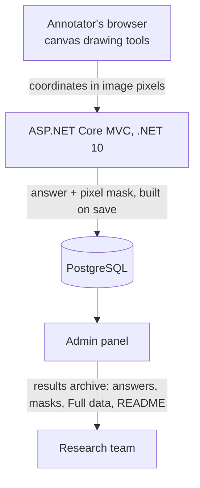

| Project | Holds |
| --- | --- |
| `src/CliniMark.Core` | Models, repository and service interfaces, annotation geometry |
| `src/CliniMark.Infrastructure` | EF Core data access, repositories, Identity, export and admin services |
| `src/CliniMark.Presentation` | MVC controllers, Razor views, the admin area, migrations and the canvas scripts |
| `tests/CliniMark.Tests` | xUnit tests on SQLite, plus a PostgreSQL concurrency test |
| `tests/js` | `node:test` tests for the browser scripts |

ASP.NET Core MVC on .NET 10, with ASP.NET Core Identity and EF Core 10 on Npgsql. The drawing tools are plain JavaScript on an HTML canvas, served beside local copies of Bootstrap 5.3.8 and jQuery 3.7.1. Every push to `master` runs both test suites in GitHub Actions, then publishes the container image to `ghcr.io`. The study runs it on Azure Container Apps.

## Running it

Docker Compose runs one web instance and PostgreSQL, with volumes for the database and the data-protection keys. Set up the database, persistent keys, hostname, trusted HTTPS proxy and backups before a public deployment.

```powershell
# Create .env from .env.example only if it doesn't exist yet, then fill in real values.
docker compose --project-name clinimark build --pull webapp
# Review and apply the schema, and load the approved image data, before starting webapp.
docker compose --project-name clinimark up -d
```

Serve the app through the reverse proxy on its public HTTPS hostname. The container's own HTTP port, 8080, listens on loopback only. At startup the app creates its roles and stops with a clear error if PostgreSQL or its migrations aren't ready.

<details>
<summary><b>Configuration</b></summary>
<br>

Keep private values in `.env`, environment variables or .NET user secrets.

| Setting | Purpose |
| --- | --- |
| `ConnectionStrings:MedDataDb` | PostgreSQL connection string |
| `DataProtection:KeysPath` | Persistent key path, required in production |
| `AllowedHosts` | Public hostname |
| `ReverseProxy:KnownProxies` | Trusted proxy addresses |
| `RateLimiting:AccessAttemptsPerTenMinutes` | Sign-in and sign-up submissions per client address every ten minutes. The default, 78, lets about 13 people join from one hospital or university network with a few retries each |
| `Database:ApplyMigrations` | On in development only; off in production Compose |
| `Database:SeedExcel` | Loads the sample Excel data; off by default |
| `Registration:Enabled` | Public sign-up, on by default. Turn it off when the study team creates accounts with `create-participants` |

Environment variables use double underscores for nested settings, such as `ConnectionStrings__MedDataDb`. Sign-up and sign-in don't need SMTP. The ignored `appsettings.Local.json` is left out of the image.
</details>

<details>
<summary><b>Running locally with the .NET SDK</b></summary>
<br>

You need the .NET 10 SDK and a running PostgreSQL. The commands use PowerShell; replace the placeholders with your own values.

```powershell
dotnet user-secrets init --project src/CliniMark.Presentation
dotnet user-secrets set "ConnectionStrings:MedDataDb" "Host=localhost;Port=5432;Database=meddatadb;Username=postgres;Password=<password>" --project src/CliniMark.Presentation

dotnet restore CliniMark.sln
dotnet build CliniMark.sln
dotnet run --project src/CliniMark.Presentation
```

The connection string can also go in the ignored `src/CliniMark.Presentation/appsettings.Local.json`. The development profiles use [https://localhost:7243](https://localhost:7243) or [http://localhost:5210](http://localhost:5210). Everyone starts at `/Identity/Login` and is sent on to `/Home/Professional`, `/Home/Student` or `/Admin`, depending on their role.
</details>

<details>
<summary><b>Database migrations</b></summary>
<br>

Development can apply migrations at startup. Production needs a reviewed script and a backup first. To generate the SQL without applying it:

```powershell
dotnet tool restore
dotnet ef migrations script --idempotent --project src/CliniMark.Presentation --startup-project src/CliniMark.Presentation --output reviewed-migrations.sql
```
</details>

### Tests

```powershell
dotnet test tests/CliniMark.Tests/CliniMark.Tests.csproj
node --test tests/js/*.test.cjs        # PowerShell: node --test (Get-ChildItem tests/js/*.test.cjs).FullName
```

The PostgreSQL concurrency test fires twenty overlapping claims at four images and checks that none goes to two people. It runs only when `CLINIMARK_TEST_POSTGRES_CONNECTION` points to a disposable `clinimark_audit_*` database.

## Licence

CliniMark is released under the [Apache License 2.0](LICENSE).
