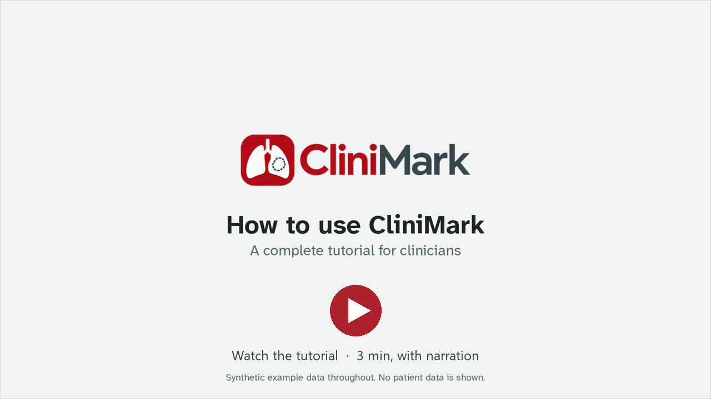
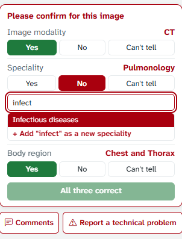
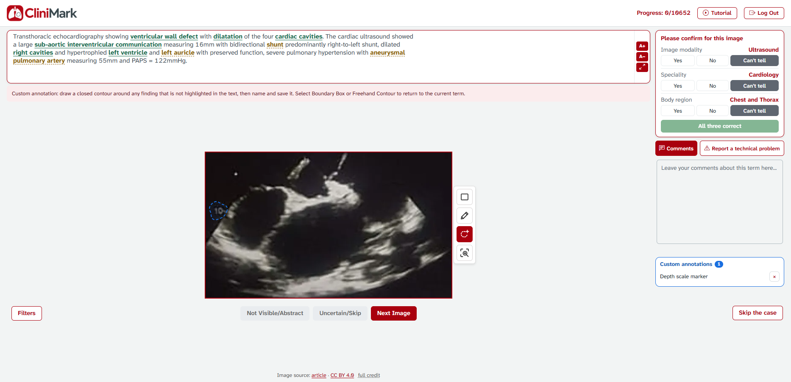

# CliniMark

CliniMark collects expert annotations on medical images from published case reports. A clinician reads the case text with its medical terms highlighted and outlines where each term shows up in the image. Medical students annotate the same images with labels of their own. Every outline is stored twice: as coordinates in the image's own pixels, and as a pixel mask that a segmentation model can be scored against.

It was built to gather ground truth for **OpenMedSeg**, an explainable AI research project for medical imaging with researchers from **Stanford Medicine, Mount Sinai, the Hasso Plattner Institute and Charité**.


[](src/CliniMark.Presentation/wwwroot/videos/clinimark-tutorial.mp4)

The tutorial above is the same video participants watch on their first visit (3 min, 21 MB download). The tour and the tutorial use synthetic images. The screenshots further down come from the test deployment, signed in with test accounts, so none of the outlines in them is a clinical judgement.

## How a session goes

1. A participant signs up and picks the images they want: at least one image modality, plus any specialities and body regions.
2. On their first visit the tutorial plays, and it has to be watched to the end once.
3. A specialist gets one case at a time and works through its highlighted terms. Each term is either outlined, marked not visible or abstract, or skipped as uncertain. A case outside their field can be handed back.
4. Before the next case, they confirm or correct the image's modality, speciality and body region.
5. A medical student gets their own queue of the same kind of images, outlines whatever they can identify and names it.
6. The study team follows progress in the admin panel and exports the results, masks included, whenever they need them.

## The specialist workspace


The case text sits above the image. Saved terms turn green, and the term being worked on is red. Comments are stored with the term they were written on, and the time from opening a term to the first stroke and on to saving is recorded for every answer.

**Report a technical problem** sends a note to the study team straight away, so it works even when the image or the drawing tools don't.



**The label check.** Next Image stays locked until the specialist has answered three questions about the image: is its modality, speciality and body region right? Each answer is Yes, No or Can't tell. Answering No opens a search over the study's own labels, and a missing value can be added.

The dataset's labels are never overwritten. `MetadataChecks` keeps what was shown next to what the specialist said, so the two can be compared later.

In the example on the right, the speciality says Pulmonology, but the case is about mucormycosis, so the specialist corrects it to Infectious diseases.

<br clear="right" />



The dashed tool is **Custom annotation**. It outlines a finding the text doesn't mention. The specialist names it, it's saved at once, and it's listed beside the image, as with the depth-scale marker above.

**Skip the case** returns a case outside the specialist's field to the pool. The next person starts it fresh, and it's never offered to the same specialist again. Anything already saved on it is first copied into `ImageSkips.DiscardedWork`, so no annotation is lost.

## The student workspace


Students outline what they can see and type their own label. Several shapes can share one label, as with the two cavities grouped above. Groups can be edited or deleted until the student submits the image.

## Drawing tools


Both workspaces offer a boundary box and a freehand contour, and Zoom to Area enlarges a region for close inspection. A selected box can be moved, resized from its corners, rotated from the round handle and deleted with X. Every coordinate is saved in the original image's pixels, whatever the screen size or zoom level.

## Signing up and choosing images

Participants create an account with their own password; there's no shared study password. Choosing **medical student** as the position gives the student workspace, and any other position gives the specialist one.

Image modality is required. Speciality and body region are optional, and leaving one empty includes all of its options. An image matches when it fits any option within each list and every list that has a selection. The options are the display labels of the CliniMark datasets (`app_labels/label_vocabulary.csv`, version `app-labels-1.1.0`): 8 image modalities, 21 specialities and 14 body regions, listed in `ImageFilterOptions`. Participants can change their choices later at `/Identity/Filters`.

<details>
<summary>View the sign-up form</summary>


</details>

**Accounts made by the study team.** With `Registration:Enabled=false`, public sign-up closes and the sign-in page says that the study team creates accounts. The team then creates them from a CSV:

```bash
dotnet CliniMark.Presentation.dll create-participants participants.csv credentials.csv
```

- Columns: `Email, FullName, Position, University, ClinicalExperience, OrcidId, Speciality, BodyRegion, ImageModality`. Separate several filter values with `;`, or leave them empty for the participant to choose at first sign-in.
- The whole file is checked before anything is written, so nothing is created if any row is invalid.
- Existing accounts are skipped and never changed.
- Generated passwords go only to the credentials file, which must not exist yet.

**Image source.** Under every image, both workspaces link the source article and its licence (`SourceUrl`, `SourceLicense`) and show the full credit line (`Attribution`). The credit sits outside the image's sizing box, so it can't shift the drawing coordinates.

## The admin panel


Admin accounts sign in on the same page and land in `/Admin`, a separate area that annotators can't open. Admins can't annotate. The overview shows live progress for both roles and an activity chart. It also lists gaps that would leave images or people without work: images that match nobody's choices, and participants who have run out of images. Further down are progress by category, drawing times, sign-ups and the results of the label check. Create an admin with the operator command `create-admin`.


Each image has a page that draws every saved annotation over the image, one layer per term or group, coloured by term or by annotator. It also shows who holds the image and lets an admin release the lock or remove the image from the study.

| Page | What it's for |
| --- | --- |
| Images | Every image with its labels, progress and lock |
| Locks | Images reserved for one person, stale and partial work first, released one at a time or together |
| Participants | Each person's choices, progress and current lock |
| Responses | Every saved answer or student group, filtered and downloaded as exactly those rows |
| Full data | One row per image-text pair, with everything anyone saved about it |
| Problems | Problems participants reported, and errors their pages logged on their own |
| Export | The full results archive, with or without the image files, and the pixel masks |
| Admin log | Every change made from the panel, and every automatic release |

<details>
<summary>View more admin pages</summary>


</details>

## What the study gets out of it


These masks come straight from the Export download. One is a specialist's answer for "ground glass opacities", the other a student's group on the same CT, scored with the Dice and IoU code that ships in the archive's README.

**Pixel masks.** Each mask is a black-and-white PNG the size of its image, with 1 inside what was drawn and 0 outside. The server computes it from the saved coordinates under a single rule: a pixel counts as inside when its centre is. All shapes drawn for one term are merged, and a contour that crosses itself is filled throughout. Masks are also stored in the database as COCO run-length encoding (`PixelMask`). For annotations saved before masks existed, the operator command `backfill-masks` fills them in.

**Full data.** One row per image-text pair that anyone has saved anything about. It holds every dataset value; each label's original value, verdict and submitted value; every answer with its coordinates, mask and timing; custom annotations, student groups, problem reports and skips. It downloads as CSV or JSON and goes into the results archive as `full_data`.


**Exports.** The results archive is a ZIP of the image list, specialist answers, student groups, participants, label checks, skips, masks and the Full data table, with a README that explains every column. Annotators appear as pseudonymous codes by default (`SPEC-001`, `STU-001`), so a file can be shared with collaborators. Full identity is a separate, deliberate choice.

<details>
<summary>Main database tables</summary>

| Table | Holds |
| --- | --- |
| `MedDatas` | Each image's metadata, progress and locks |
| `MedDataKeywords` | The terms extracted from each image's text |
| `AnnotatedMedDatas` | Specialists' answers, one row per term |
| `AnnotatedByStudentsMedDatas` | Students' labelled groups |
| `CustomAnnotations` | Findings a specialist outlined and named themselves |
| `MetadataChecks` | Specialists' verdicts on each image's modality, speciality and body region |
| `ImageSkips` | Cases a specialist handed back, with a copy of anything they had saved |
| ASP.NET Core Identity tables | Accounts and roles |

</details>

## Why it's built this way

Annotation data is only useful if it can be trusted. Most of the design follows from that.

**One image, one specialist.** Handing out a case takes a PostgreSQL advisory lock (`pg_advisory_xact_lock`) for the whole assignment step. Two specialists who press Next Image in the same instant can't receive the same image, so each image ends up with one complete set of answers rather than several half-finished ones. Students have a separate queue with its own lock, so an image can collect one set from each group.

**Masks are made on the server.** The browser sends only coordinates. Turning them into pixels happens in one place with one rule, so a mask never depends on someone's screen, zoom level or canvas implementation.

**Original labels stay untouched.** When a specialist corrects an image's modality, speciality or body region, the correction is stored beside the original value, not over it. That disagreement is itself data the study wants.

**Saves survive a restart.** If the server is restarting when an answer is sent (HTTP 502, 503 or 504, or no connection), the page retries for about 80 seconds (`wwwroot/js/requestRetry.js`). The server refuses a second save of the same term or image, so a retry can never store an answer twice.

**Nothing is quietly lost.** A skipped case keeps a copy of whatever was saved on it. A lock an admin releases keeps its partial work as an incomplete set. Exports read a consistent snapshot (repeatable read), so they never pause annotators.

**Production starts only when it's set up properly.** It never migrates or seeds itself. Startup stops with a clear message if the database, its migrations or the data-protection key path are missing. Pages use a Content Security Policy with a per-request nonce, and sign-in and sign-up are rate-limited per client address. The limit is set high enough that a group joining from one hospital network, behind one shared address, still gets in.

## Architecture

| Project | Holds |
| --- | --- |
| `src/CliniMark.Core` | Models, repository and service interfaces, annotation geometry |
| `src/CliniMark.Infrastructure` | EF Core data access, repositories, Identity, export and admin services |
| `src/CliniMark.Presentation` | MVC controllers, Razor views, the admin area, migrations and the canvas scripts |
| `tests/CliniMark.Tests` | xUnit tests on SQLite, with a PostgreSQL concurrency test |
| `tests/js` | `node:test` tests for the browser scripts |

ASP.NET Core MVC on .NET 10, with ASP.NET Core Identity for accounts and EF Core 10 with Npgsql for PostgreSQL. The drawing tools are plain JavaScript on an HTML canvas, served next to local copies of Bootstrap 5.3.8 and jQuery 3.7.1. EPPlus reads the optional Excel seed. A GitHub Actions workflow runs both test suites on every push to `master`, then publishes the image to `ghcr.io/arkhunabdullazade/clinimark`. The study deployment runs on Azure Container Apps.

## Running it

### With Docker

Docker Compose runs one web instance and PostgreSQL, with volumes for the database and the data-protection keys. Before a public deployment, set up the database, persistent keys, hostname, trusted HTTPS proxy and backups.

```powershell
# Create .env from .env.example only if it doesn't exist yet, then fill in real values.
docker compose --project-name clinimark build --pull webapp
# Review and apply the schema, and load the approved image data, before starting webapp.
docker compose --project-name clinimark up -d
```

Serve the app through the reverse proxy on its public HTTPS hostname. The container's own HTTP port, 8080, listens on loopback only. At startup the app creates its roles and stops with a clear error if PostgreSQL or its migrations aren't ready. Sample Excel seeding is off unless you turn it on.

<details>
<summary>Configuration</summary>

Keep private values in `.env`, environment variables or .NET user secrets.

| Setting | Purpose |
| --- | --- |
| `ConnectionStrings:MedDataDb` | PostgreSQL connection string |
| `DataProtection:KeysPath` | Persistent key path, required in production |
| `AllowedHosts` | Public hostname |
| `ReverseProxy:KnownProxies` | Trusted proxy addresses |
| `RateLimiting:AccessAttemptsPerTenMinutes` | Sign-in and sign-up submissions allowed per client address every ten minutes. The default, 78, allows about 13 people joining together from one hospital or university network, with a few retries each |
| `Database:ApplyMigrations` | On in development only; off in production Compose |
| `Database:SeedExcel` | Loads the sample Excel data; off by default |
| `Registration:Enabled` | Public sign-up, on by default. Turn it off when the study team creates accounts with `create-participants` |

Environment variables use double underscores for nested settings, such as `ConnectionStrings__MedDataDb`. Sign-up and sign-in don't need SMTP. The ignored `appsettings.Local.json` is left out of the image.

</details>

<details>
<summary>Running locally with the .NET SDK</summary>

You need the .NET 10 SDK and a running PostgreSQL. The commands use PowerShell; replace the placeholders with your own values.

```powershell
dotnet user-secrets init --project src/CliniMark.Presentation
dotnet user-secrets set "ConnectionStrings:MedDataDb" "Host=localhost;Port=5432;Database=meddatadb;Username=postgres;Password=<password>" --project src/CliniMark.Presentation

dotnet restore CliniMark.sln
dotnet build CliniMark.sln
dotnet run --project src/CliniMark.Presentation
```

The connection string can also go in the ignored `src/CliniMark.Presentation/appsettings.Local.json`. The development profiles use [https://localhost:7243](https://localhost:7243) or [http://localhost:5210](http://localhost:5210); use the URL printed at startup. Everyone starts at `/Identity/Login` and is sent on to `/Home/Professional`, `/Home/Student` or `/Admin`, depending on their role.

</details>

<details>
<summary>Database migrations</summary>

Development can apply migrations at startup. Production needs a reviewed script and a backup first. To generate the SQL without applying it:

```powershell
dotnet tool restore
dotnet ef migrations script --idempotent --project src/CliniMark.Presentation --startup-project src/CliniMark.Presentation --output reviewed-migrations.sql
```

</details>

## Tests

```powershell
dotnet test tests/CliniMark.Tests/CliniMark.Tests.csproj
node --test tests/js/*.test.cjs        # PowerShell: node --test (Get-ChildItem tests/js/*.test.cjs).FullName
```

The PostgreSQL concurrency test, which checks that parallel assignment never hands one image to two people, runs only when `CLINIMARK_TEST_POSTGRES_CONNECTION` points to a disposable `clinimark_audit_*` database.

## Earlier versions

<details>
<summary>Demo videos and walkthroughs from before the redesign</summary>

These show the app before it was renamed and redesigned, so some tools look different, and the magnifier has since been replaced by Zoom to Area.

**Specialist demo, 56 seconds.** Drawing regions, using the magnifier, adding comments and moving between terms.

https://github.com/user-attachments/assets/94dad84d-b075-431b-9890-afe414f0dc13

**Student demo, 50 seconds.** Creating regions, assigning labels and editing annotation groups.

https://github.com/user-attachments/assets/b1e7f00c-6cef-4361-a3d1-9c89e0a28a19

Longer walkthroughs: [the full application](https://drive.google.com/file/d/1WtMTApfPg1Q_AMeK0-lMWVt-EKZZpWtu/view?usp=sharing) and [registration](https://drive.google.com/file/d/10KE4MSIjdLQpE0J9nxgl21jFsLJl3jjM/view?usp=sharing).

| Region coordinates | Annotation timing |
| --- | --- |
|  |  |


</details>

## License

[Apache License 2.0](LICENSE).
