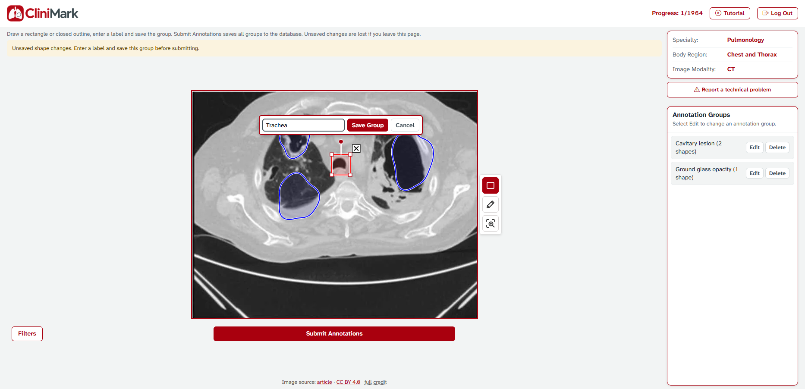
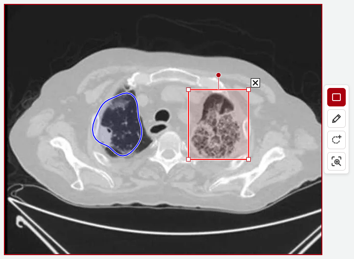
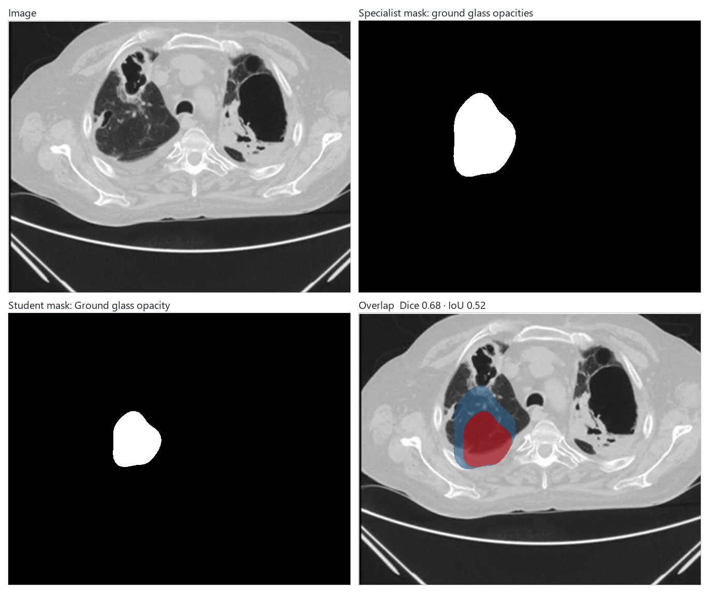
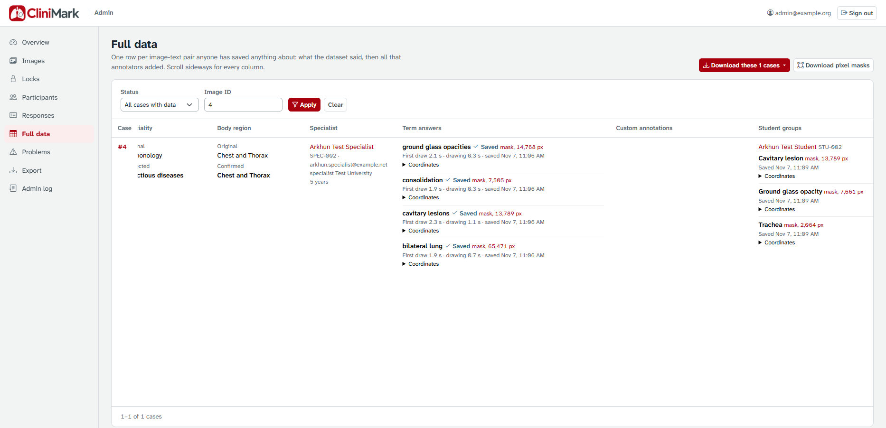
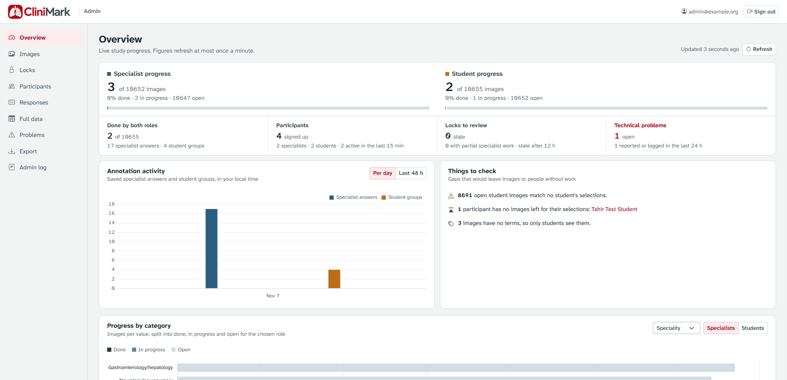
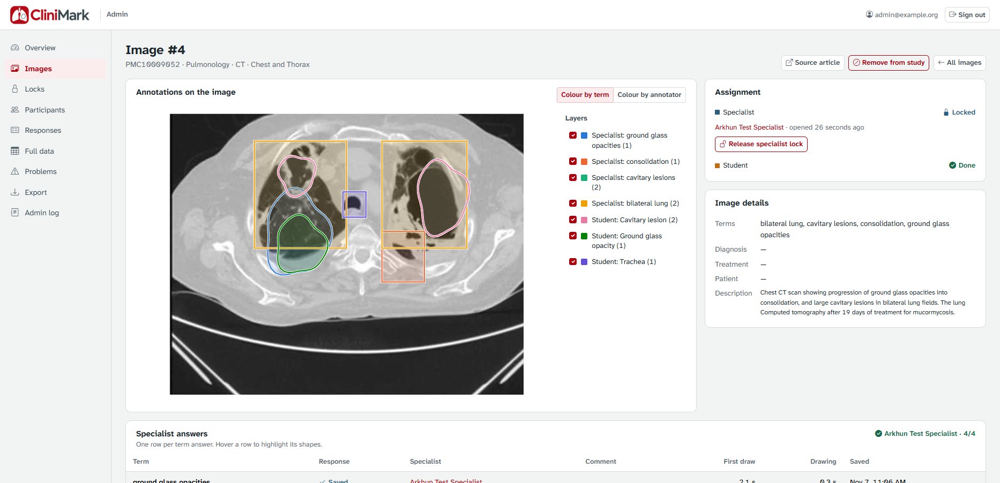
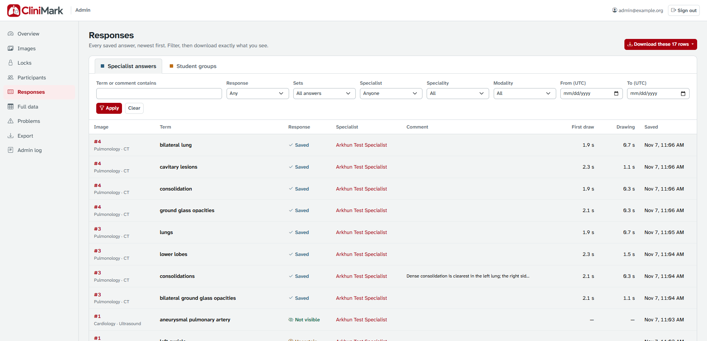
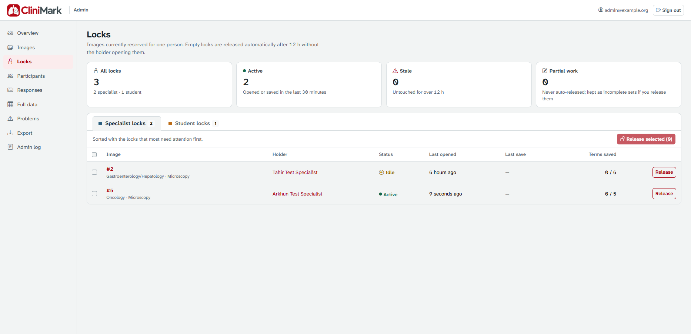
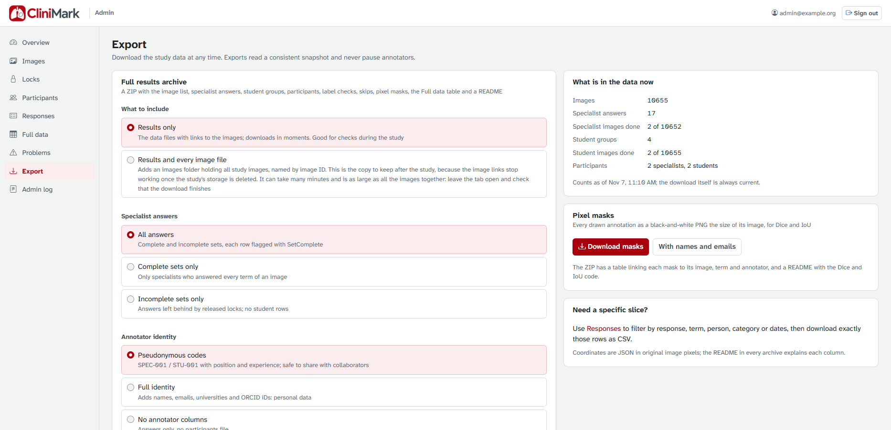

# CliniMark

A web application for collecting structured annotations on medical publication images. Medical specialists mark regions associated with terms in the source text; medical students identify visible findings and supply their own labels. Both workflows preserve annotation data for research and future AI evaluation.

CliniMark was used to collect structured medical image annotations for the evaluation of **OpenMedSeg**, an explainable AI research project for medical imaging involving researchers from **Stanford Medicine, Mount Sinai, the Hasso Plattner Institute, and Charité**.

Built with **ASP.NET Core MVC, .NET 10, and PostgreSQL**, with custom canvas tools for rectangle and freehand annotation.

[Full walkthrough](https://drive.google.com/file/d/1WtMTApfPg1Q_AMeK0-lMWVt-EKZZpWtu/view?usp=sharing)

**The screenshots come from the test deployment, signed in with test accounts; the demo videos show an earlier version.** Drawn regions and labels illustrate the interface, rather than validated medical annotations.

## Annotation workflows

### Medical specialists: annotate against source terms

Specialists work through highlighted medical terms in the publication text and mark the corresponding image regions. They can add comments, flag a term as not visible or abstract, or skip it when uncertain. Saving advances to the next term and records annotation timing.


Saved terms turn green in the text, the current term is red, and the label check sits beside the image. **Report a technical problem** sends a note to the study team at once, even when the image or the tools fail to load.

Before moving on, specialists confirm or correct the image's modality, speciality and body region (Yes, No, Can't tell). Next Image stays locked until all three are answered; the box turns yellow and the status line says so in bold red once every term is saved. The dataset's own labels are never overwritten: `MetadataChecks` records what was shown and what the specialist said, for comparison later.

| Correcting a label | Every term answered |
| --- | --- |
|  |  |

**No** opens a search over the study's labels, and a value that isn't listed can be added. **Custom annotation** (the dashed tool) outlines any finding that isn't highlighted in the text; the specialist names it, it is saved at once, and it is listed beside the image.

**Tutorial.** The first time a participant reaches their annotation page, the tutorial video opens by itself and has to be watched to the end, without skipping ahead. `AspNetUsers.TutorialWatchedAt` records that. If the video can't load, they can carry on and it opens again next time. The Tutorial button in the header replays it at any time.

<details>
<summary>View the tutorial on first sign-in</summary>


</details>

**Skip the case** sends a case outside the specialist's field back to the pool. It starts fresh for the next person, with nothing from the first specialist left in the results, and is never offered to that specialist again. Anything they had saved on it is copied into `ImageSkips.DiscardedWork` first, so no annotation is destroyed.

**Specialist demo · 56 seconds.** Drawing regions, using the magnifier, adding comments, and moving between terms.

https://github.com/user-attachments/assets/94dad84d-b075-431b-9890-afe414f0dc13

### Medical students: identify and label findings

Students annotate what they can identify and assign free-text labels. Regions can be grouped under a shared label, edited, or deleted before submission. These annotations provide a separate source of data for supplementary evaluation.



**Student demo · 50 seconds.** Creating regions, assigning labels, and editing annotation groups.

https://github.com/user-attachments/assets/b1e7f00c-6cef-4361-a3d1-9c89e0a28a19

### Drawing tools

Both workflows provide boundary box and freehand contour tools, with zoom to area for inspecting small details. A selected box can be moved, resized from its corners, rotated from the round handle and deleted with X.

| Boundary box and freehand contour regions |
| --- |
|  |

### Participant access and image assignment

Participants register or log in with their own account password through ASP.NET Core Identity; there is no shared access password. Ordinary email addresses are accepted; ownership confirmation is not required. At least one image modality is required; speciality and body region are optional, and an empty list includes all of its options. Every list supports multiple options. Images match any selected option within each list and must match every list that has a selection. Selections can be changed at `/Identity/Filters`.

Selecting `medical student` assigns the `Medical_Student` role; other positions receive `Professional`. Each role has its own annotation workspace.

The filter options are the display labels of the CliniMark datasets (`app_labels/label_vocabulary.csv`, `app-labels-1.1.0`): 14 body regions, 21 specialities and 8 image modalities, listed in `ImageFilterOptions` (`src/CliniMark.Presentation/Dtos/ImageFiltersDto.cs`). Image rows store these exact texts. Matching ignores case and surrounding spaces.

**Accounts created by the study team.** With `Registration:Enabled=false`, public signup is closed and the sign-in page says that the study team creates accounts. Create them from a CSV with the operator command below:
- Columns: `Email, FullName, Position, University, ClinicalExperience, OrcidId, Speciality, BodyRegion, ImageModality`. Filter values are separated by `;` and may be empty, in which case the participant chooses them at first sign-in.
- The whole file is checked first: nothing is created if any row is invalid.
- Existing accounts are skipped and never changed.
- Generated passwords go only to the credentials file, which must not exist yet.

```bash
dotnet CliniMark.Presentation.dll create-participants participants.csv credentials.csv
```

**Image source.** Under every image, both workspaces show the source article and licence links from `SourceUrl` and `SourceLicense`, and the full credit line (`Attribution`). The line sits outside the image's sizing box, so it never changes drawing coordinates. The results export includes both columns.

**Saving during a restart.** If the app is restarting when a save is sent (HTTP 502/503/504, or no connection), the page repeats the save for about 80 seconds (`wwwroot/js/requestRetry.js`). The server refuses a second save of the same term or image, so a repeated save can never store anything twice.

<details>
<summary>View participant registration</summary>


The registration screen asks for the participant's details and the images they want to annotate. The [full walkthrough](https://drive.google.com/file/d/10KE4MSIjdLQpE0J9nxgl21jFsLJl3jjM/view?usp=sharing) provides the broader application demo.

</details>

## Stored annotations and progress

PostgreSQL stores annotations alongside source-image and participant metadata. Professional records include region coordinates, term decisions, comments, and timing data; student records retain grouped regions and their labels.

Saved keyword states preserve progress when a specialist has not finished every term on an image. Separate ownership fields—`LockedByUserId` for professionals and `LockedByStudentUserId` for students—hold one person per image in each workflow: every assignment takes a database-wide lock, so two specialists working in parallel can never receive the same image, and one specialist's set is the only one an image gets. The specialist and student workflows are independent, so an image can have one set from each. Completion is tracked through `IsAnnotated` and `IsAnnotatedByStudent`.

**Pixel masks.** Every drawn annotation is stored twice: as coordinates, and as a binary mask of the whole image (1 inside the shape, 0 outside) for evaluating segmentation models with Dice and IoU. The server computes the mask from the coordinates when the annotation is saved (`AnnotationMask`), so it doesn't depend on the annotator's browser: a pixel is inside when its centre is, the shapes of one term are merged, and a contour that crosses itself is filled throughout. Masks are kept as COCO run-length encoding in `PixelMask`. The admin Export page downloads them as PNG files the size of each image, with an index table and a README. For annotations saved before masks existed, run the operator command `backfill-masks`.



The masks above come straight from the Export download: a specialist's answer and a student's group on the same image, compared with the Dice and IoU code in the archive's README.

**Full data.** The admin panel's Full data page shows one row per image-text pair anyone has saved anything about: every dataset value, each label's original value, verdict and submitted value, every answer with its coordinates, mask and timing, custom annotations, student groups, problem reports and skips. It downloads as CSV or JSON and is included in the results archive as `full_data`.



<details>
<summary>Raw table rows</summary>

| Region coordinates | Annotation timing |
| --- | --- |
|  |  |


</details>

<details>
<summary>Main database tables</summary>

| Table | Purpose |
| --- | --- |
| `MedDatas` | Source-image metadata, progress, and locks |
| `MedDataKeywords` | Extracted terms associated with images |
| `AnnotatedMedDatas` | Professional annotation records |
| `AnnotatedByStudentsMedDatas` | Student annotation groups |
| `CustomAnnotations` | Findings a specialist outlined and named themselves |
| `MetadataChecks` | Specialists' verdicts on each image's modality, speciality and body region |
| `ImageSkips` | Images a specialist sent back, and a copy of anything they had saved on them |
| ASP.NET Core Identity tables | User accounts and roles |

</details>

## Admin panel

Admin accounts sign in at the same page and land on `/Admin`, a separate area that annotators can't open. Admins can't annotate. Create one with the operator command `create-admin`.



The overview shows live progress for both roles, an activity chart, and gaps that would leave images or people without work. It also shows progress by category, drawing times, sign-ups, and how specialists answered the label check.



Each image's page draws every saved annotation over the image, one layer per term or group, coloured by term or by annotator. It shows who holds the image and can release the lock or remove the image from the study.

| Page | What it shows |
| --- | --- |
| Images | Every image with its labels, progress and lock, filterable |
| Locks | Images reserved for one person, stale and partial work first; release one or many |
| Participants | Everyone who signed up, their selections, progress and current lock |
| Responses | Every saved answer or student group, filterable, downloadable as exactly those rows |
| Full data | One row per image-text pair with everything saved about it |
| Problems | Technical problems reported by participants and errors their pages logged |
| Export | The full results archive, with or without image files, and the pixel masks |
| Admin log | Every change made from the panel and every automatic release |

<details>
<summary>View more admin pages</summary>








</details>

## Architecture and stack

| Layer | Project | Contents |
| --- | --- | --- |
| Core | `src/CliniMark.Core` | Models, repositories, and core services |
| Infrastructure | `src/CliniMark.Infrastructure` | Data access, repository implementations, services, and settings |
| Presentation | `src/CliniMark.Presentation` | MVC controllers, Razor views, DTOs, migrations, and static assets |

The application uses ASP.NET Core Identity for accounts, EF Core 10 with Npgsql for PostgreSQL access, and EPPlus for optional Excel seed data. The interface uses locally served Bootstrap 5.3.8, jQuery 3.7.1, and custom canvas tools. Docker Compose runs one web instance and PostgreSQL, with persistent database and data-protection-key volumes.

## Run with Docker

Configure the intended database, persistent keys, hostname, trusted HTTPS proxy and backups before public deployment. Production does not automatically migrate or seed data.

```powershell
# Create .env from .env.example only if it does not exist; configure real values.
docker compose --project-name clinimark build --pull webapp
# Review/apply the schema and load approved image data before starting webapp.
docker compose --project-name clinimark up -d
```

Use the public HTTPS hostname through the reverse proxy. Container HTTP is loopback-only on port 8080.

Startup initializes the two roles and fails clearly if PostgreSQL or its migration state is not ready. Sample Excel seeding is opt-in and false by default.

### Configuration

Keep private values in `.env`, environment variables, or .NET user secrets.

| Setting | Purpose |
| --- | --- |
| `ConnectionStrings:MedDataDb` | PostgreSQL connection string |
| `DataProtection:KeysPath` | Required persistent key path in production |
| `AllowedHosts` | Public hostname |
| `ReverseProxy:KnownProxies` | Explicit trusted proxy addresses |
| `RateLimiting:AccessAttemptsPerTenMinutes` | Sign-in and sign-up submissions allowed per client address every ten minutes (default 78: about 13 people joining together from one hospital or university network, with a few retries each) |
| `Database:ApplyMigrations` | Defaults to development only; false in production Compose |
| `Database:SeedExcel` | Opt-in sample seed, false by default |
| `Registration:Enabled` | Public signup (default true). Set `false` when the study team creates the accounts with `create-participants` |

Environment variables use double underscores for nested settings, such as `ConnectionStrings__MedDataDb`. SMTP is not required for research signup/sign-in. Ignored `appsettings.Local.json` is excluded from the image.

<details>
<summary>Run locally with the .NET SDK</summary>

Requires the .NET 10 SDK and a running PostgreSQL instance. The commands below use PowerShell; replace the placeholders with your local values.

```powershell
dotnet user-secrets init --project src/CliniMark.Presentation
dotnet user-secrets set "ConnectionStrings:MedDataDb" "Host=localhost;Port=5432;Database=meddatadb;Username=postgres;Password=<password>" --project src/CliniMark.Presentation

dotnet restore CliniMark.sln
dotnet build CliniMark.sln
dotnet run --project src/CliniMark.Presentation
```

Alternatively, set the database connection in ignored `src/CliniMark.Presentation/appsettings.Local.json`. Development launch profiles use [https://localhost:7243](https://localhost:7243) or [http://localhost:5210](http://localhost:5210); use the URL printed at startup.

Entry route: `/Identity/Login`. After authentication, users are routed to `/Home/Professional` or `/Home/Student`.

</details>

<details>
<summary>Manual database migrations</summary>

Development can apply the existing migrations at startup. Production requires a reviewed script and backup. Generate SQL without applying it:

```powershell
dotnet tool restore
dotnet ef migrations script --idempotent --project src/CliniMark.Presentation --startup-project src/CliniMark.Presentation --output reviewed-migrations.sql
```

</details>

## Testing

- .NET tests: `dotnet test tests/CliniMark.Tests/CliniMark.Tests.csproj`.
- JavaScript tests: `node --test tests/js/*.test.cjs` (PowerShell: `node --test (Get-ChildItem tests/js/*.test.cjs).FullName`).
- PostgreSQL concurrency test: set `CLINIMARK_TEST_POSTGRES_CONNECTION` to a disposable `clinimark_audit_*` database.

Images need an image modality to be assigned, because that filter is required. The app targets .NET 10 (LTS).

## License

Licensed under the [Apache License 2.0](LICENSE).
